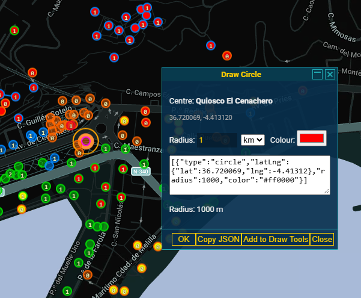
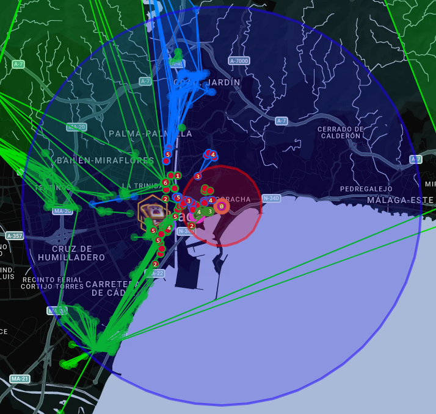

# iitc-draw-circle-assets

Screenshots for [Draw Circle](https://github.com/Grifwl/iitc-draw-circle), an IITC plugin
for Ingress that draws an exact-radius Draw Tools circle centred on a portal.

This repo is kept **public** and separate from the main `iitc-draw-circle` source (which
is private) so its images can be embedded via `raw.githubusercontent.com` both in the
plugin's own documentation and in its published description on
[iitc.willbe.blue](https://iitc.willbe.blue).

## Contents

- `screenshots/drawing-circle.png` — the Draw Circle dialog, with the shard presets and
  the fields for a custom radius, unit and colour.
- `screenshots/circle-drawn.png` — the three shard circles (1 / 5 / 10 km) drawn on the
  map around the same portal.

